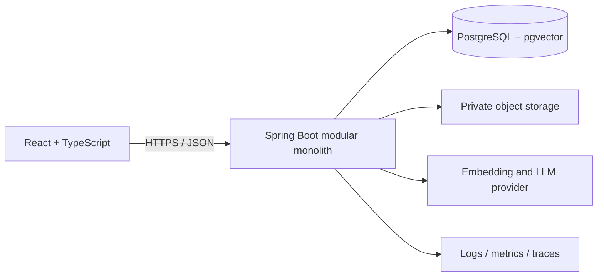

# Architecture

## Initial deployment shape

In local development, the starter runs the API and frontend directly on the host and runs PostgreSQL/pgvector in Docker Compose. File storage, embedding provider and LLM provider will be added in later slices.

## Backend modules (planned)

- `identity`: authentication, current principal and memberships.
- `organizations`: organization and role administration.
- `knowledgebase`: knowledge-base CRUD and authorization.
- `documents`: upload validation, metadata, storage lifecycle and status.
- `ingestion`: text extraction, normalization, chunking and embedding.
- `retrieval`: permission-filtered retrieval and source ranking.
- `answering`: prompt assembly, LLM invocation, abstention and citation validation.
- `audit`: security events and administrative activity.
- `observability`: request IDs, latency, error rate and token/cost metrics.

Keep module boundaries clear, but deploy as one Spring Boot application until there is a measured reason to split a module into a service.

## Non-negotiable boundaries

1. Authenticate each request before accessing tenant data.
2. Scope every data query to the server-derived organization identity. Never trust an organization ID supplied only by the client.
3. Check access before retrieving document chunks and before sending any content to an external model.
4. Keep original uploaded files in private storage; the database stores metadata and references.
5. Treat document text as untrusted input. Retrieved text is evidence, not instructions to the model.
6. Persist the exact chunk/source references used to compose an answer so citations are auditable.
7. Do not log secrets, full prompts containing sensitive user content, or uploaded document bodies by default.

## Why PostgreSQL + pgvector

V1 needs relational data for tenants, users, memberships, documents and conversations, plus vector similarity retrieval. Keeping both in PostgreSQL reduces operational complexity for a portfolio-scale application. Add a vector index only after selecting an embedding model and fixed embedding dimensions.
