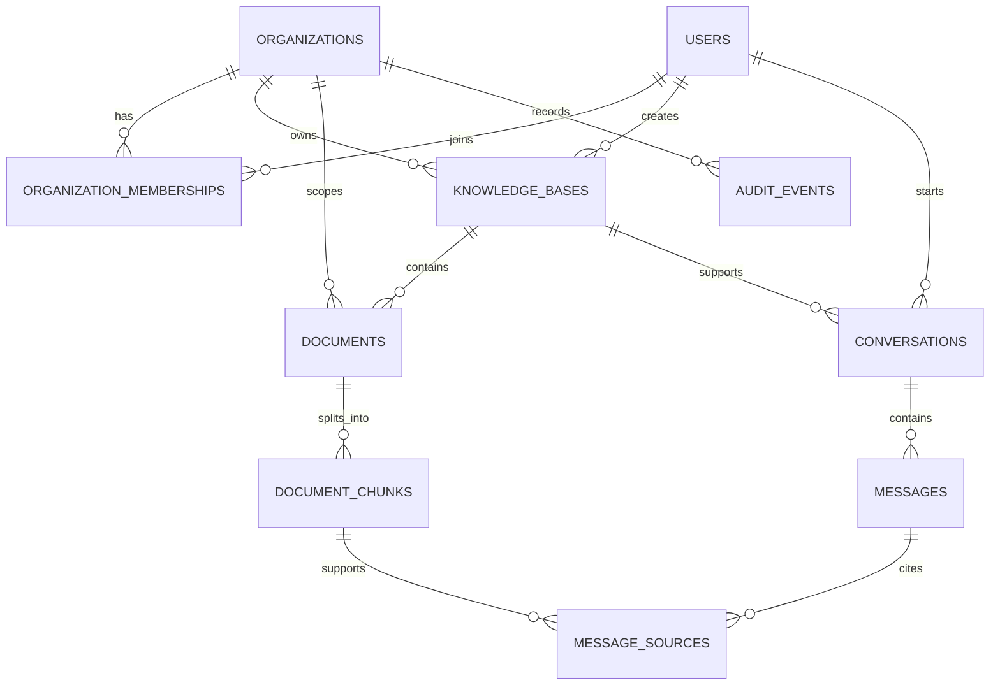

# Initial data model

See `backend/src/main/resources/db/migration/V1__initial_schema.sql` for the schema created by Flyway.

## Entity relationships

## Design notes

- UUID primary keys are used for API-facing entities.
- `organization_id` is persisted on tenant-owned resources, including chunks, so authorization and tenant filtering can be explicit.
- The `document_chunks` foreign key uses `(organization_id, document_id)` to keep a chunk associated with a document in the same organization.
- Vector dimension and index are intentionally deferred until an embedding model has been selected. The `vector` column is currently dimension-flexible; production indexing should use a fixed model/dimension and be validated against real data.
- Document storage is referenced by `storage_key`; original bytes should live in private object storage, not in the relational database.
- `message_sources` records the exact chunks referenced by each answer.
- Audit metadata must not contain document body text, passwords, API keys or unnecessary sensitive data.

The initial schema is a starting point. Review and test migrations before a production release; schema presence alone does not enforce tenant authorization.
